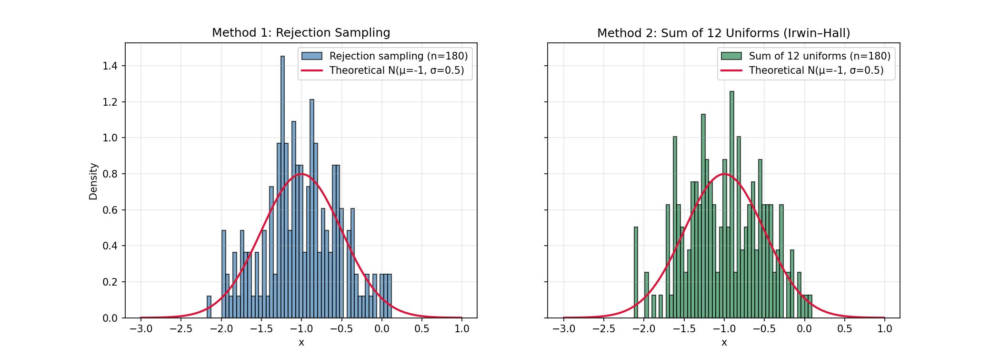
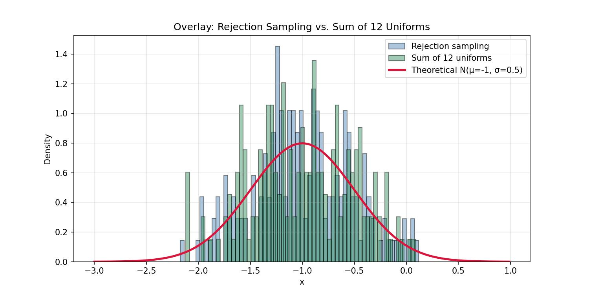

# Protokol č. 2 - Generátory náhodných čísel

- **Autor: Ondřej Hruboš**
- Datum: 05.11.2026
- Předmět: Simulace systémů
- Č. zadání: 7
- Ročník/Skupina: 4./Út. 8:00

V rámci zadání č. 2 jsem vytvořil dva generátory náhodných čísel s normálním rozložením pomocí dvou metod:

1. Zamítací metoda,
1. Algoritmus generování hodnot náhodné veličiny s normálním rozdělením $N(μ;σ^2)$ odvozený na základě Lindenbergovy-Lévyho centrální limitní věty[^1].

Pro oba algoritmy byly zvoleny stejné parametry $μ = -1$, $σ^2 = 0,5$ a bylo generováno 180 hodnot. Výsledky byly v závěru porovnány mezi sebou a s ideálním rozložením.

**Zamítací metoda** generuje náhodný bod $[x; y]$ v obdélníku, kde $x$ je rovnoměrně rozdělené v intervalu $\langle μ-3σ; μ+3σ \rangle$ a $y$ v intervalu $\langle 0; 1{,}05 \cdot f(μ) \rangle$, kde $f$ je hustota normálního rozdělení. Pokud bod leží pod křivkou hustoty ($y \le f(x)$), je hodnota $x$ přijata, jinak je zamítnuta. Postup se opakuje, dokud není vygenerováno 180 hodnot. Nevýhodou je, že část vygenerovaných bodů se zahazuje, a že metoda neprodukuje hodnoty mimo interval $μ \pm 3σ$.

**Suma 12** využívá centrální limitní větu. Součet 12 nezávislých rovnoměrně rozdělených hodnot $R_i \sim U(0;1)$ má střední hodnotu 6 a rozptyl 1, proto má veličina $U = \sum_{i=1}^{12} R_i - 6$ přibližně rozdělení $N(0;1)$. Výsledná hodnota se získá transformací $X = μ + σ \cdot U$[^1].

## Výsledky
| Metoda | Střední hodnota | Rozptyl | Směrodatná odchylka | 25% kvantil | 75% kvantil |
|---|---:|---:|---:|---:|---:|
| Zamítací metoda | -0.9949 | 0.2351 | 0.4848 | -1.2872 | -0.6360 |
| Součet 12 | -0.9953 | 0.2380 | 0.4879 | -1.3386 | -0.6321 |
| Teoretické hodnoty | -1.0000 | 0.2500 | 0.5000 | -1.3372 | -0.6628 |

[^1]: https://new-moodle.utb.cz/pluginfile.php/533607/mod_resource/content/0/simulace_skripta_statistika_2.pdf
